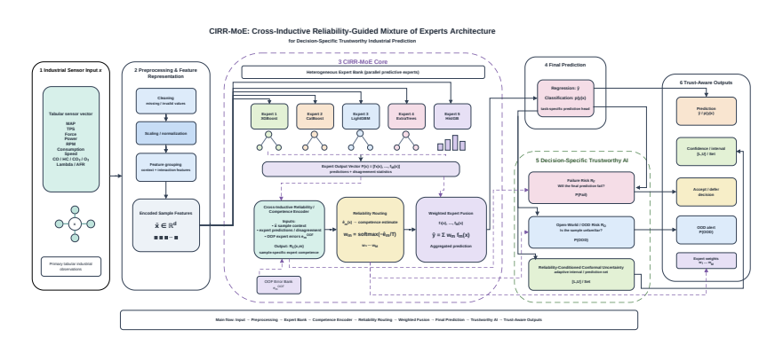
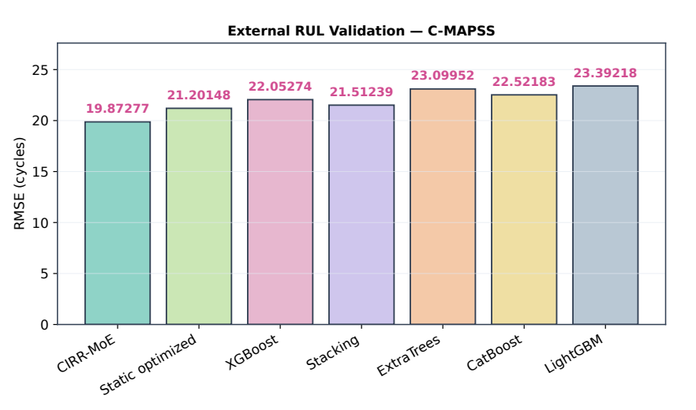
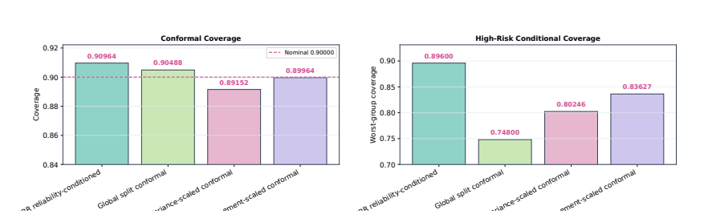

# CIRR-MoE
### Cross-Inductive Reliability-Guided Mixture of Experts for Decision-Specific Trustworthy Industrial Prediction

**Mehedi Hasan · Aniqua Nusrat Zereen · Mohammad M. Abdullah-Al-Wadud · Jia Uddin**

[Manuscript](paper/paper.pdf) · [Results](#reported-results) · [Reliability](#decision-specific-reliability) · [Code availability](#code-availability)

**Expert competence · Prediction-failure risk · Open-world unfamiliarity**

*Figure 2 from the accompanying manuscript.*

## Overview

CIRR-MoE treats three deployment questions separately: **which expert is locally competent**, **whether the fused prediction is likely to fail**, and **whether the input is unfamiliar**. It learns sample-specific routing from genuine out-of-fold expert errors and combines that routing with failure-aware abstention, unknown-condition detection, and reliability-conditioned conformal inference.

**Research status:** manuscript under review; acceptance is not claimed. This repository contains the author-supplied [manuscript](paper/paper.pdf), selected figures, and documentation of its reported experiments.

## Method

The heterogeneous expert bank comprises **XGBoost, CatBoost, LightGBM, ExtraTrees, and histogram gradient boosting**. Cross-fitting produces held-out predictions and losses, which supervise competence estimates rather than deriving trust from in-sample fit.

| Quantity | Question | Use |
| --- | --- | --- |
| R_C | Which expert should receive responsibility for this sample? | Temperature-controlled routing and fusion |
| R_F | Is the final prediction likely to fail? | Risk ranking, abstention, interval scaling |
| R_O | Is the sample outside familiar support? | Unknown-condition detection and rejection |

Development folds determine reliability models and routing temperatures. Pseudo-open development withholds known classes; the final true-unknown classes remain separate from that development process.

## Benchmarks and protocols

| Dataset | Task | Evaluation design |
| --- | --- | --- |
| EngineFaultDB | RPM estimation and four-class fault analysis | 55,999 records; held-out development/evaluation |
| NASA C-MAPSS FD001 | Remaining useful life | Engine-grouped development and official test engines |
| Tennessee Eastman Process | Unknown-fault detection | Batch-separated; faults 4, 8, 12, 16, and 20 withheld |
| PHM 2009 gearbox | Classification and unknown-condition detection | Archive-grouped records and held-out unknown conditions |

EngineFaultDB RPM is an operating-state target, **not remaining useful life**. Its strong Speed-RPM correlation (r = 0.99689) helps explain the very high R². C-MAPSS provides the distinct external RUL experiment.

## Reported results

These values are transcribed from the accompanying manuscript and have not been independently rerun for this repository.

| Task | Metric | CIRR-MoE |
| --- | --- | ---: |
| EngineFaultDB RPM | R² | 0.99696 |
| EngineFaultDB RPM | RMSE | 51.42646 |
| C-MAPSS FD001 RUL | R² | 0.77130 |
| C-MAPSS FD001 RUL | RMSE, cycles | 19.87277 |
| C-MAPSS FD001 RUL | MAE, cycles | 15.26274 |
| PHM gearbox classification | Accuracy | 0.93750 |
| PHM gearbox classification | Macro-F1 | 0.93651 |
| PHM gearbox classification | NLL / ECE | 0.18679 / 0.07810 |

### External RUL comparison

| Method | RMSE, cycles ↓ |
| --- | ---: |
| **CIRR-MoE** | **19.87277** |
| Static optimized fusion | 21.20148 |
| Stacking | 21.51239 |
| XGBoost | 22.05274 |
| CatBoost | 22.52183 |
| ExtraTrees | 23.09952 |
| LightGBM | 23.39218 |

*Figure 4: the manuscript's engine-grouped RUL comparison.*

## Decision-specific reliability

| Evaluation | Reported result |
| --- | ---: |
| Regression failure-risk AUROC | 0.79905 |
| Classification error-awareness AUROC | 0.94074 |
| TEP true-unknown AUROC | 0.90822 |
| PHM true-unknown AUROC, decision-specific fusion | 0.82448 |
| Conformal empirical coverage at nominal 90% | 0.90964 |
| Highest-risk quartile coverage | 0.89600 |
| Global conformal highest-risk quartile coverage | 0.74800 |

*Figure 9: reliability-conditioned conformal coverage. The high-risk-quartile result is an empirical subgroup measurement, not a general conditional-coverage guarantee.*

Component ablations examine cross-fitting, reliability routing, disagreement features, the failure head, the OOD module, and conformal calibration. Expert-removal and sensor-noise experiments examine complementary expert behavior and degradation under corruption.

## Interpretation and limitations

- EngineFaultDB lacks true acquisition-session identifiers, limiting prospective session-aware conclusions.
- PHM archive grouping reduces sibling leakage but leaves a smaller effective evaluation sample for unknown-condition estimates.
- Different reliability signals perform best on different tasks: unfamiliarity and prediction error are not interchangeable.
- Selective results concern accepted subsets; perfect scores at low retained coverage do not describe the full population.
- Conformal guarantees depend on exchangeability; distribution shift and sensor corruption can invalidate transferred calibration.

## Code availability

**Code will be available upon acceptance of the paper.** The current release contains documentation and figures; it does not yet contain training scripts, dataset manifests, model artifacts, or a runnable reproduction package.

## Reference

Mehedi Hasan, Aniqua Nusrat Zereen, Mohammad M. Abdullah-Al-Wadud, and Jia Uddin. *CIRR-MoE: Cross-Inductive Reliability-Guided Mixture of Experts for Decision-Specific Trustworthy Industrial Prediction*. Manuscript, 2026. [PDF](paper/paper.pdf).

See [figure provenance](assets/README.md). Dataset redistribution and use remain subject to the respective original providers' terms.

[Research profile](https://github.com/mhasan96) · [Website](https://sites.google.com/view/i-am-mehedi) · [Contact](mailto:hasanme1@msu.edu)
